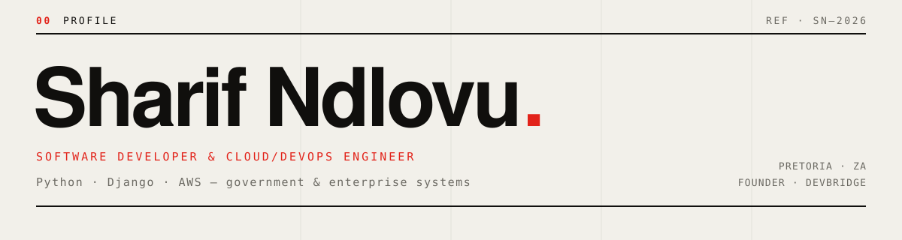
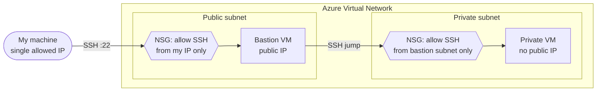

<picture>
  <source media="(prefers-color-scheme: dark)" srcset="assets/banner-dark.svg">
  
</picture>

  Cloud and DevOps engineer and Python/Django developer who builds, releases and operates production platforms.
  I'm the sole infrastructure engineer on two live government systems: I write the AWS infrastructure, run the deployments and monitor production across QA, UAT and Production, with security scanning built into every release.

  🏢 Founder of <a href="https://devbridge.co.za"><b>DevBridge</b></a>, a Pretoria-based software and cloud infrastructure company serving government and enterprise clients across South Africa.

> [!NOTE]
> **Open to opportunities:** hybrid or remote work in the Centurion / Pretoria area.

  
  
  
  
  

---

### `01` &nbsp;Projects

Several of these are government systems, so I don't link them directly. Full write-ups are on my [portfolio](https://portfolio.devbridge.co.za).

<table>
  <tr>
    <td width="50%" valign="top">
      <b>Livi</b> · <code>live</code> 
      Multi-tenant citizen-services platform, Office of the Premier, Mpumalanga
      <ul>
        <li>Sole infrastructure engineer: CloudFormation, GitHub Actions deployments and production monitoring</li>
        <li>Security-gated releases: pip-audit and a Trivy image scan must pass before an image can be pushed</li>
        <li>Contributed to the app: 10 departments on 30 subdomains, SLA escalation, SSE chat, automated upload screening with Rekognition</li>
      </ul>
    </td>
    <td width="50%" valign="top">
      <b>e-PGLUM</b> · <code>live</code> 
      Nationwide land-use and building-plan management, live for CoGHSTA, Mpumalanga
      <ul>
        <li>Sole infrastructure engineer across QA, UAT and Production; sole maintainer since go-live</li>
        <li>Migrated live infrastructure from AWS Copilot to standalone CloudFormation</li>
        <li>Backend contributor in a team of 7: workflow engine over a 96-form codebase, async document pipeline</li>
      </ul>
    </td>
  </tr>
  <tr>
    <td width="50%" valign="top">
      <b>The Workplace Basics</b> · <code>not launched</code> 
      Django commerce and publishing platform (sole developer)
      <ul>
        <li>Paystack subscriptions with signature-verified webhooks</li>
        <li>Tiered free and premium access</li>
        <li>S3 media pipeline, Celery + Redis. The client cancelled before go-live; it became the groundwork for the government systems</li>
      </ul>
    </td>
    <td width="50%" valign="top">
      <b>Community Web Modernization</b> · <code>pro bono</code> 
      Programme: 6 sites for schools, churches, NGOs and sports clubs
      <ul>
        <li>Static sites on Cloudflare, no server or database to attack</li>
        <li>Full source handover so each organisation can maintain its own site</li>
        <li><a href="https://www.devbridge.co.za/community">The programme</a> · example: <a href="https://rehobothboerdery.co.za/">Rehoboth Boerdery</a></li>
      </ul>
    </td>
  </tr>
</table>

### `02` &nbsp;Products I'm building at DevBridge

Our own products, with the codebases largely complete and now heading into users' hands. Feature additions and gap-filling follow once real feedback comes in.

<table>
  <tr>
    <td width="50%" valign="top">
      <b>EO Risk Platform</b> · <code>in development</code> 
      Satellite Imagery · Risk Analytics · REST API · Insurance  
      A B2B satellite-imagery analytics API that turns Earth observation data into property risk scores for insurers. One call returns a composite score, hazard exposure and the evidence behind them.
    </td>
    <td width="50%" valign="top">
      <b>Heavy Fleet Intelligence</b> · <code>in development</code> 
      Telemetry · CAN / J1939 · MQTT 5 · Multi-Tenant  
      A white-label, hardware-agnostic operational intelligence platform for mining and heavy logistics: live telemetry, trip reconstruction, route compliance and stop analysis over industrial gateways.
    </td>
  </tr>
</table>

### `03` &nbsp;Personal projects

Self-directed and public on GitHub.

- **[siteward](https://github.com/sharifndlovu123/siteward)**: self-hostable passive web security scanner with JSON, Markdown and HTML export.
- **[speedward](https://github.com/sharifndlovu123/speedward)**: self-hostable website performance tester with a global map.
- **[NetPulse](https://github.com/sharifndlovu123/iot_monitoring)**: Django platform that discovers and monitors devices on a local network.
- **[Remote Workstation Anywhere](https://github.com/sharifndlovu123/Remote-Workstation-Anywhere-)**: wake and connect to a home desktop with Tailscale, Wake-on-LAN, RDP and a Raspberry Pi gateway.
- **[aws-playground](https://github.com/sharifndlovu123/aws-playground)**: dozens of AWS services explored through the CLI, infrastructure as code and SDKs.
- **[terraform_associate](https://github.com/sharifndlovu123/terraform_associate)**: code-first study notes and runnable examples.

### `04` &nbsp;Stack

  
  
  
  
  
  
  
  
  
  
  

| | |
| --- | --- |
| **Languages** | Python (expert), Java, JavaScript, C# (.NET MVC), Kotlin, SQL, Delphi |
| **AWS compute & delivery** | ECS Fargate, Lambda, CloudFront, Route 53, ACM, CloudFormation |
| **AWS storage & data** | S3, EFS, RDS, ElastiCache |
| **AWS messaging & events** | SQS, SNS, EventBridge, SES |
| **AWS security & ops** | IAM, KMS, Secrets Manager, WAF, CloudWatch, Rekognition |
| **Data & messaging** | PostgreSQL, PostGIS, MySQL, Redis, pgvector, RabbitMQ, Amazon MQ, Celery |
| **DevOps & IaC** | Docker, Git, GitHub Actions, CI/CD, CloudFormation, Terraform, Bash |
| **DevSecOps** | Trivy, pip-audit, AWS WAF |
| **Monitoring & Linux** | CloudWatch, production troubleshooting, Linux administration and hardening |

#### 🔐 Network isolation in practice: Azure bastion host

Only the bastion in the public subnet is reachable from the internet, and only from my own IP. The private VM has no public address, so the only way in is an SSH jump through the bastion.

Network security groups restrict inbound SSH at both layers.

### `05` &nbsp;Record

<table>
  <tr>
    <td width="50%" valign="top">
      <b>Certifications</b>
      <ul>
        <li>AWS Certified Solutions Architect – Associate</li>
        <li>AWS Certified Developer – Associate</li>
        <li>AWS Certified Cloud Practitioner</li>
        <li>Microsoft Certified: Azure Fundamentals (AZ-900)</li>
        <li>CompTIA Network+</li>
        <li>CompTIA Project+</li>
      </ul>
    </td>
    <td width="50%" valign="top">
      <b>Education</b>
      <ul>
        <li>BSc Computer &amp; Application Development, Varsity College (2021–2023)</li>
        <li>Programming Languages &amp; AI short course, University of Pretoria (2025)</li>
      </ul>
      <b>Currently (2026)</b>
      <ul>
        <li>In progress: AZ-104 Azure Administrator</li>
        <li>2027: CompTIA Linux+ · HashiCorp Terraform Associate · Kubernetes &amp; Helm · Prometheus &amp; Grafana · OpenTelemetry · Jenkins · advanced DevSecOps · reliability engineering</li>
      </ul>
    </td>
  </tr>
</table>

### `06` &nbsp;Knowledge base

I keep my study notes in public at **[knowledgebase.devbridge.co.za](https://knowledgebase.devbridge.co.za)**: a regularly updated hub covering cloud, databases, Linux, networking, orchestration and programming. They're rough working notes, tidied with an LLM, written as I learn.

<code>Pretoria · ZA</code> &nbsp;·&nbsp; <code>REF · SN—2026</code>
