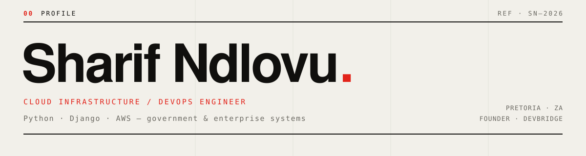
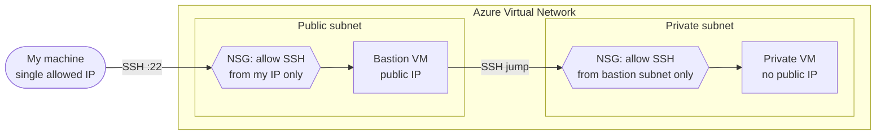

<picture>
  <source media="(prefers-color-scheme: dark)" srcset="assets/banner-dark.svg">
  
</picture>

  Python and cloud engineer with production AWS and Django experience across QA, UAT and Production.
  I ship live government and commercial platforms, owning both the application and the infrastructure underneath it.

  🏢 Founder of <a href="https://devbridge.co.za"><b>DevBridge</b></a>, a Pretoria-based software and cloud infrastructure company serving government and enterprise clients across South Africa.

> [!NOTE]
> **Open to opportunities:** hybrid or remote work in the Centurion / Pretoria area.

  
  
  
  
  

---

### `01` &nbsp;Projects

Several of these are government systems, so I don't link them directly. Full write-ups are on my [portfolio](https://portfolio.devbridge.co.za).

<table>
  <tr>
    <td width="50%" valign="top">
      <b>Livi</b> · <code>live</code> 
      Multi-tenant citizen-services platform, Office of the Premier, Mpumalanga
      <ul>
        <li>One Django deployment serving 10 departments across 30 subdomains</li>
        <li>Celery Beat + Amazon MQ SLA escalation across 12 queues</li>
        <li>SSE chat, Rekognition media gating, DRF mobile API on ECS Fargate</li>
      </ul>
    </td>
    <td width="50%" valign="top">
      <b>e-PGLUM</b> · <code>live</code> 
      Nationwide land-use and building-plan management, live for CoGHSTA, Mpumalanga
      <ul>
        <li>Owned the full AWS estate (QA, UAT, Production) in a team of 7</li>
        <li>Configurable workflow engine over a 96-form codebase</li>
        <li>Async S3 document pipeline, CloudFormation</li>
      </ul>
    </td>
  </tr>
  <tr>
    <td width="50%" valign="top">
      <b>The Workplace Basics</b> 
      Django commerce and publishing platform
      <ul>
        <li>Paystack subscriptions with HMAC-SHA512 webhook verification</li>
        <li>Tiered access with JWT sessions</li>
        <li>S3 presigned URLs, Celery + Redis</li>
      </ul>
    </td>
    <td width="50%" valign="top">
      <b>Community Web Modernization</b> · <code>pro bono</code> 
      Annual programme: 6 sites for schools, churches, NGOs and sports clubs
      <ul>
        <li>Static sites on Cloudflare Pages</li>
        <li>Automatic HTTPS and DDoS protection</li>
        <li>Full source handover</li>
      </ul>
    </td>
  </tr>
</table>

### `02` &nbsp;Products I'm building at DevBridge

Our own products, with the codebases largely complete and now heading into users' hands. Feature additions and gap-filling follow once real feedback comes in.

<table>
  <tr>
    <td width="50%" valign="top">
      <b>EO Risk Platform</b> · <code>in development</code> 
      Satellite Imagery · Risk Analytics · REST API · Insurance  
      A B2B satellite-imagery analytics API that turns Earth observation data into property risk scores for insurers. One call returns a composite score, hazard exposure and the evidence behind them.
    </td>
    <td width="50%" valign="top">
      <b>Heavy Fleet Intelligence</b> · <code>in development</code> 
      Telemetry · CAN / J1939 · MQTT 5 · Multi-Tenant  
      A white-label, hardware-agnostic operational intelligence platform for mining and heavy logistics: live telemetry, trip reconstruction, route compliance and stop analysis over industrial gateways.
    </td>
  </tr>
</table>

### `03` &nbsp;Stack

  
  
  
  
  
  
  
  
  
  
  

| | |
| --- | --- |
| **Languages** | Python (expert), Java, JavaScript, C# (.NET MVC), Kotlin, SQL, Delphi |
| **Data & messaging** | PostgreSQL, PostGIS, MySQL, Redis, pgvector, RabbitMQ, Amazon MQ, Celery |
| **DevOps** | Docker, Git, GitHub Actions, CI/CD, Infrastructure as Code |

<b>Full AWS service list</b>

 

ECS Fargate, Lambda, S3, EFS, RDS, ElastiCache, SQS, SNS, EventBridge, SES, CloudFront, Route 53, ACM, IAM, KMS, Secrets Manager, Rekognition, CloudWatch, CloudFormation, WAF

<b>Azure bastion host: SSH into a private subnet</b>

 

A network-isolation pattern I built on Azure: only the bastion in the public subnet is reachable from the internet, and only from my own IP. The private instance has no public address at all.

Firewall rules (network security groups) restrict inbound SSH at both layers, so the private VM can only be reached by jumping through the bastion.

### `04` &nbsp;Record

<table>
  <tr>
    <td width="50%" valign="top">
      <b>Certifications</b>
      <ul>
        <li>AWS Certified Solutions Architect – Associate</li>
        <li>AWS Certified Developer – Associate</li>
        <li>AWS Certified Cloud Practitioner</li>
        <li>Microsoft Certified: Azure Fundamentals (AZ-900)</li>
        <li>CompTIA Network+</li>
        <li>CompTIA Project+</li>
      </ul>
    </td>
    <td width="50%" valign="top">
      <b>Education</b>
      <ul>
        <li>BSc Computer &amp; Application Development, Varsity College (2021–2023)</li>
        <li>Programming Languages &amp; AI short course, University of Pretoria (2025)</li>
      </ul>
      <b>Currently (2026)</b>
      <ul>
        <li>Studying: AZ-204 Azure Developer · CompTIA Linux+ · HashiCorp Terraform Associate · Bash</li>
        <li>Up next: Kubernetes · Jenkins CI/CD · Firebase &amp; NoSQL</li>
      </ul>
    </td>
  </tr>
</table>

### `05` &nbsp;Knowledge base

I keep my study notes in public at **[knowledgebase.devbridge.co.za](https://knowledgebase.devbridge.co.za)**: a regularly updated hub covering cloud, databases, Linux, networking, orchestration and programming. They're rough working notes, tidied with an LLM, written as I learn.

<code>Pretoria · ZA</code> &nbsp;·&nbsp; <code>REF · SN—2026</code>
